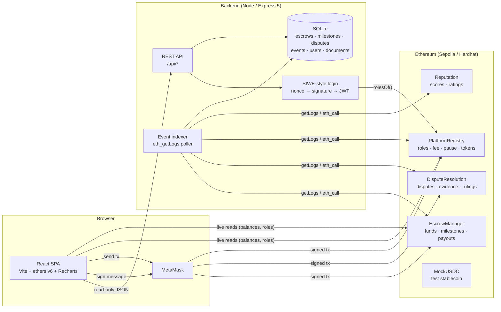
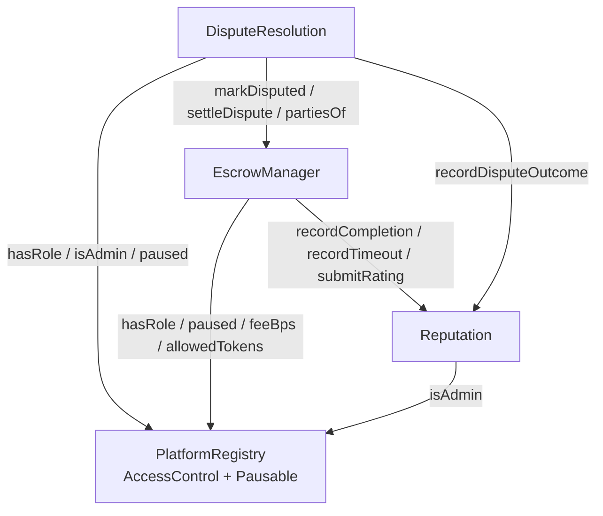
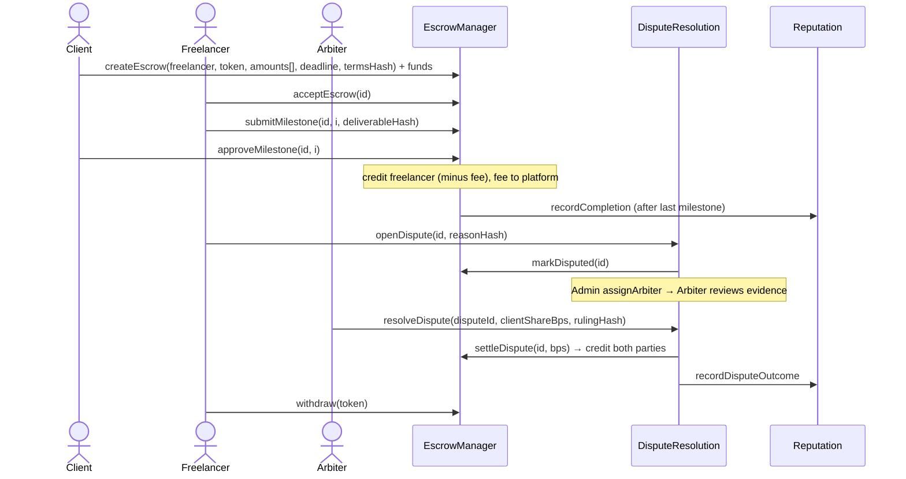
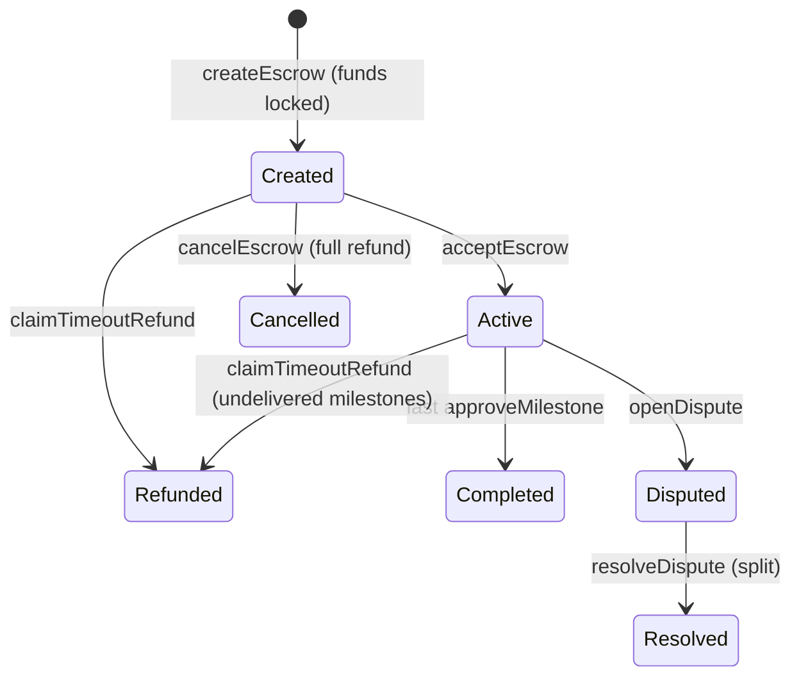
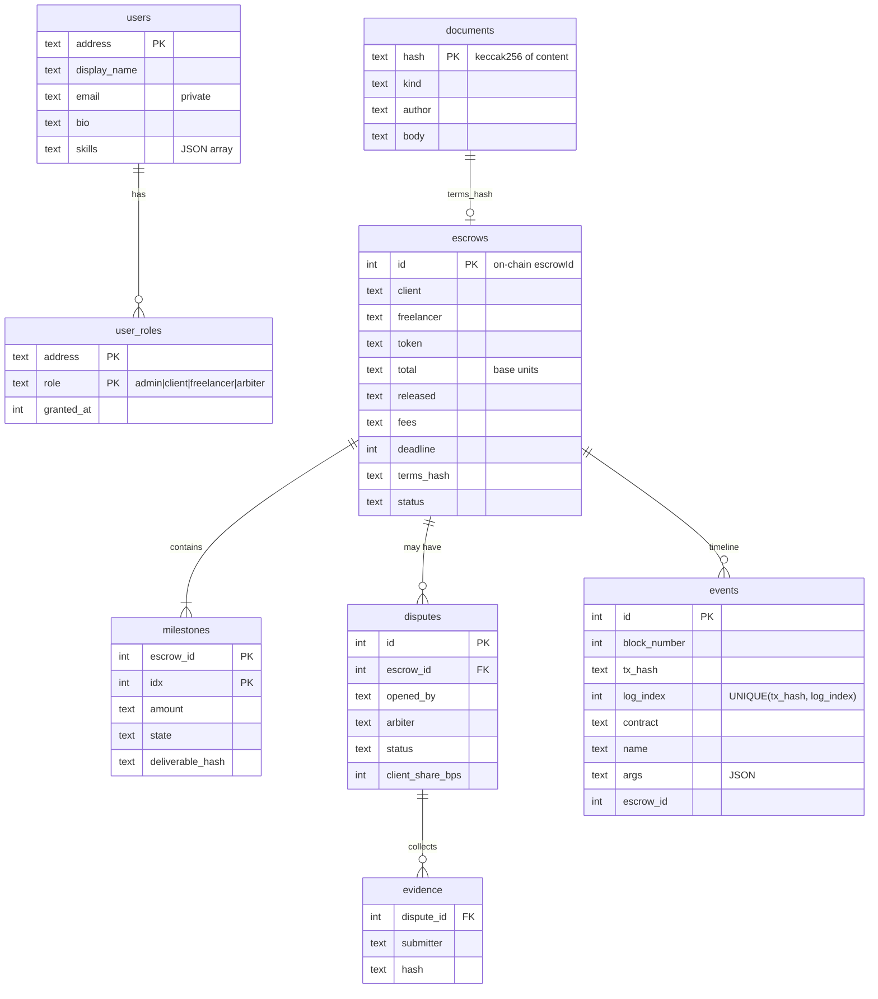

# TrustLane — Milestone Escrow for Freelancers and SMEs

SC6113 group project · enterprise-grade financial DApp on Ethereum (Sepolia testnet).

Small businesses and freelancers who don't know each other need a neutral party
to hold money while work is delivered. TrustLane replaces that intermediary with
smart contracts: the client locks the full budget (ETH or a USD stablecoin) in
escrow, the freelancer delivers milestone by milestone, each approval releases
that milestone's payment, a missed deadline refunds the client automatically,
and disagreements go to an on-chain arbiter who splits the remaining funds.
Every completed job, dispute and rating feeds an on-chain reputation score.

| Requirement | Where it is met |
|---|---|
| ≥ 3 roles, role-based auth | **Admin, Client, Freelancer, Arbiter** — OpenZeppelin `AccessControl` in `PlatformRegistry`; enforced in every contract, re-checked by the API (`requireRole`) and used to drive the UI |
| MetaMask, wallet-signed transactions | `frontend/src/context/WalletContext.jsx` (connect, switch/add Sepolia, every write signed in MetaMask) |
| ≥ 3 inter-calling contracts | `EscrowManager` ↔ `DisputeResolution` ↔ `Reputation`, all reading `PlatformRegistry` (diagram below) |
| ≥ 10 on-chain transaction types | **21 on the core contracts + 2 on the test token** (table below) |
| REST API + persistent DB + error handling | `backend/` — Express 5 + SQLite (better-sqlite3), SIWE-style wallet login → JWT, central error middleware |
| Event sync | `backend/src/indexer.js` polls `eth_getLogs`, decodes events, updates read-model tables idempotently |
| Responsive dashboard, tx history, event log, charts | `frontend/` — React + Vite + ethers v6 + Recharts |
| Gas estimation & optimisation | per-tx estimate dialog in the UI; `docs/gas-analysis.md` with measured numbers |
| Contract tests | 64 Hardhat/chai tests, 100 % statements / 93.6 % branches; plus 12 API tests |
| Cloud deployment | Sepolia deploy script; `render.yaml` blueprint for API + frontend (see *Deployment*) |

---

## Architecture



The chain is the source of truth for money and roles. The database is a
**read model** rebuilt from events (plus off-chain profile data and the text of
documents whose hashes are anchored on-chain), so the API can serve lists,
filters, history and statistics without hammering the RPC.

### Contract interactions





### Escrow state machine



---

## Roles

| Role | How obtained | Can do |
|---|---|---|
| **Admin** (`DEFAULT_ADMIN_ROLE`) | deployer (or `ADMIN_ADDRESS`) | set fee (≤ 10 %), allow tokens, pause/unpause, grant/revoke arbiters, assign arbiters to disputes, withdraw platform fees, authorise reputation writers |
| **Client** (`CLIENT_ROLE`) | self-register (`registerAs`) | create & fund escrows, approve milestones, cancel, dispute, rate |
| **Freelancer** (`FREELANCER_ROLE`) | self-register (`registerAs`) | accept jobs, submit milestones, dispute, rate, withdraw |
| **Arbiter** (`ARBITER_ROLE`) | granted by Admin | rule on disputes assigned to them (must not be a party; revocation takes effect immediately) |

A wallet can hold several roles. Roles are enforced on-chain; the backend reads
them with one call (`rolesOf(address)` → bitmask) and re-checks them on every
privileged API request.

## Transaction types (on-chain, state-changing)

| # | Contract | Function | Caller | Purpose |
|---|---|---|---|---|
| 1 | PlatformRegistry | `registerAs(role)` | anyone | onboard as Client or Freelancer |
| 2 | PlatformRegistry | `grantRole(ARBITER_ROLE, a)` | Admin | appoint an arbiter |
| 3 | PlatformRegistry | `revokeRole(ARBITER_ROLE, a)` | Admin | remove an arbiter |
| 4 | PlatformRegistry | `setPlatformFee(bps)` | Admin | change fee (cap 1000 bps) |
| 5 | PlatformRegistry | `setTokenAllowed(token, bool)` | Admin | allow-list a payment token |
| 6 | PlatformRegistry | `pause()` | Admin | circuit breaker |
| 7 | PlatformRegistry | `unpause()` | Admin | resume |
| 8 | EscrowManager | `createEscrow(...)` (payable) | Client | create job and lock ETH or ERC20 |
| 9 | EscrowManager | `acceptEscrow(id)` | Freelancer | accept terms |
| 10 | EscrowManager | `submitMilestone(id, i, hash)` | Freelancer | deliver work (hash of deliverable) |
| 11 | EscrowManager | `approveMilestone(id, i)` | Client | release milestone payment |
| 12 | EscrowManager | `cancelEscrow(id)` | Client | cancel before acceptance, full refund |
| 13 | EscrowManager | `claimTimeoutRefund(id)` | anyone (keeper) | refund undelivered milestones after deadline |
| 14 | EscrowManager | `rateCounterparty(id, 1..5)` | Client / Freelancer | rate the other party once |
| 15 | EscrowManager | `withdraw(token)` | anyone with a balance | pull credited funds |
| 16 | EscrowManager | `withdrawFees(token, to)` | Admin | collect platform fees |
| 17 | EscrowManager | `setDisputeResolver(addr)` | Admin (once) | wire the dispute module |
| 18 | DisputeResolution | `openDispute(escrowId, reasonHash)` | party | freeze funds, start dispute |
| 19 | DisputeResolution | `submitEvidence(disputeId, hash)` | party | attach evidence |
| 20 | DisputeResolution | `assignArbiter(disputeId, a)` | Admin | assign/re-assign an arbiter |
| 21 | DisputeResolution | `resolveDispute(disputeId, bps, rulingHash)` | assigned Arbiter | split the locked funds |
| 22 | Reputation | `setUpdater(module, bool)` | Admin | authorise modules to write reputation |
| 23 | MockUSDC | `faucet()` | anyone (1/hour) | get 10,000 test mUSDC |
| 24 | MockUSDC | `approve(escrow, amount)` | Client | ERC20 allowance before an mUSDC escrow |

Internal cross-contract calls (not user transactions): `markDisputed`,
`settleDispute`, `recordCompletion`, `recordTimeout`, `recordDisputeOutcome`,
`submitRating`.

## Data model (backend SQLite)



Also `auth_nonces` (one-time sign-in messages) and `sync_state` (indexer cursor).
Amounts are stored as decimal strings of base units because wei values do not
fit SQLite's 64-bit integers.

## REST API

| Method | Path | Auth | Description |
|---|---|---|---|
| GET | `/api/health` | – | DB, RPC and indexer status |
| GET | `/api/auth/nonce?address=` | – | one-time EIP-4361-style message to sign |
| POST | `/api/auth/verify` | – | `{address, signature}` → `{token, roles}` |
| GET | `/api/auth/me` | JWT | own profile (incl. private email) + live roles |
| GET | `/api/escrows?status=&client=&freelancer=&party=&page=&pageSize=` | – | paginated list |
| GET | `/api/escrows/:id` | – | escrow + milestones + dispute + evidence + event timeline |
| GET | `/api/events?contract=&name=&address=&escrowId=&page=` | – | event log / per-address transaction history |
| GET | `/api/events/names` | – | event names + counts (filter options) |
| GET | `/api/users/:address` | – | public profile, roles, job stats, on-chain reputation |
| PUT | `/api/users/me` | JWT | update own profile (validated) |
| POST | `/api/documents` | JWT | store terms/deliverable/evidence/ruling text, returns its keccak256 for on-chain anchoring |
| GET | `/api/documents/:hash` | – | fetch document + `verified` re-hash check |
| GET | `/api/stats?days=` | – | totals, status breakdown, locked value per token, daily series, dispute rate, top freelancers |
| GET | `/api/disputes?status=&arbiter=` | – | dispute list |
| GET | `/api/disputes/assigned` | JWT + Arbiter | arbiter's queue |
| GET | `/api/admin/overview` | JWT + Admin | indexer health, role counts, on-chain fee/pause/fees |
| GET | `/api/admin/arbiters` | JWT + Admin | arbiters with open-case counts |

Errors always look like `{"error": {"code": "BAD_REQUEST", "message": "...", "details": ...}}`
with proper HTTP status (400 validation, 401 auth, 403 role, 404, 409 conflict,
413 payload, 429 rate limit on `/api/auth`, 500 without internal details).

---

## Run locally (Windows / macOS / Linux)

Prerequisites: Node.js ≥ 20 (tested on 24.12), MetaMask.

```powershell
# 1) install
cd contracts; npm install; cd ..
cd backend;   npm install; cd ..
cd frontend;  npm install; cd ..

# 2) terminal A: local chain (keeps running)
cd contracts
npx hardhat node

# 3) terminal B: deploy + demo data (writes addresses/ABIs into backend/ and frontend/)
cd contracts
npm run deploy:local
npm run seed:local        # optional: 8 demo escrows covering every state

# 4) terminal C: API + indexer on http://localhost:4000
cd backend
npm start                 # copy .env.example to .env to change settings

# 5) terminal D: frontend on http://localhost:5173
cd frontend
npm run dev
```

MetaMask for local testing: add network *Hardhat Local* (RPC
`http://127.0.0.1:8545`, chain id 31337; the app offers to add it) and import
one of the private keys printed by `npx hardhat node`. Those keys are public
test keys — never use them on a real network. Account #0 is Admin; after
`seed:local`, #1–#2 are Clients, #3–#4 Freelancers, #5 both, #6 Arbiter.
If you restart `hardhat node`, re-run the deploy and delete `backend/data/`
(MetaMask may also need *Settings → Advanced → Clear activity tab data*).

### Tests

```powershell
cd contracts
npx hardhat test          # 64 tests + gas report -> gas-report.txt / gas-report.json
npx hardhat coverage      # coverage report
npx hardhat run scripts/gas-benchmark.js   # controlled gas scenarios -> docs/gas-benchmark.json

cd ../backend
npm test                  # 12 API tests (node:test, in-memory DB)
```

## Deployment

### 1. Contracts → Sepolia

```powershell
cd contracts
copy .env.example .env    # fill SEPOLIA_RPC_URL and DEPLOYER_PRIVATE_KEY (a test-only wallet with Sepolia ETH)
npm run deploy:sepolia
```

The script deploys and wires all contracts, writes
`contracts/deployments/sepolia.json` (addresses, start block, gas per step) and
copies addresses + ABIs to `backend/src/contracts/` and
`frontend/src/contracts/` under chain id `11155111`. It prints the
`npx hardhat verify` commands for Etherscan (needs `ETHERSCAN_API_KEY`).

### 2. Backend + frontend → cloud

`render.yaml` is a Render Blueprint for both services:

- **trustlane-api** (Node web service, `/api/health` health check, 1 GB disk for
  SQLite, generated `JWT_SECRET`). Set `RPC_URL`, `CORS_ORIGINS`, `SIWE_DOMAIN`.
  Without a persistent disk (free plan) the DB is re-built by the indexer from
  the deployment block on restart; only off-chain profiles/documents are lost.
- **trustlane-web** (static site, SPA rewrite). Set `VITE_API_URL` to the API URL.

The frontend also deploys as-is to Vercel (`frontend/vercel.json`) or Netlify
(`frontend/public/_redirects`) with the same two `VITE_*` variables.

---

## Security notes

- Checks-effects-interactions everywhere; `ReentrancyGuard` on functions that move value; tested with a malicious re-entrant receiver.
- Pull payments: no function pushes value to a counterparty, so a reverting receiver cannot block a job.
- Fee snapshot per job: changing the fee never affects live escrows; hard cap 10 %.
- Fee-on-transfer/rebasing tokens rejected (received amount must equal the declared total).
- Pause stops new money and progress but never blocks exits (cancel, timeout refund, withdraw).
- Delivered-but-unreviewed work cannot be clawed back by the timeout refund; it must be approved or disputed.
- Arbiters must hold `ARBITER_ROLE` at ruling time and cannot be a party to the dispute.
- Wallet login: single-use, 5-minute nonces bound to address + chain id; signature recovered server-side; JWT carries no authority beyond identity — roles are re-read from chain.
- API: input validation on every parameter, body size limit, rate limit on auth, CORS allow-list, generic 500 messages.

## Project structure

```
SC6113-group/
├── contracts/                 Hardhat project
│   ├── contracts/             PlatformRegistry, EscrowManager, DisputeResolution, Reputation, mocks/
│   ├── test/                  64 tests (unit, permissions, edge cases, re-entrancy, integration)
│   ├── scripts/               deploy.js, seed.js, export.js, gas-benchmark.js
│   └── gas-report.txt         generated by `npx hardhat test`
├── backend/                   Express 5 + SQLite + indexer
│   ├── src/                   app.js, server.js, auth.js, indexer.js, db.js, errors.js, routes/
│   └── test/api.test.js
├── frontend/                  React + Vite + ethers v6 + Recharts
│   └── src/                   context/WalletContext.jsx, pages/, components/, lib/
├── docs/
│   ├── gas-analysis.md        measured gas analysis (draft)
│   ├── gas-benchmark.json
│   └── screenshots/
└── render.yaml                cloud deployment blueprint
```

## Known limitations / next steps

- Indexer handles reorgs only through a confirmation lag (`CONFIRMATIONS`); a deep reorg needs a re-sync.
- Statistics are aggregated in JS per request; fine for coursework scale, would need materialised totals for large volumes.
- Seeded demo jobs have no stored titles (their term hashes were created by the seed script, not via the API).
- Documents are stored in the backend DB; IPFS pinning would remove that trust assumption.
